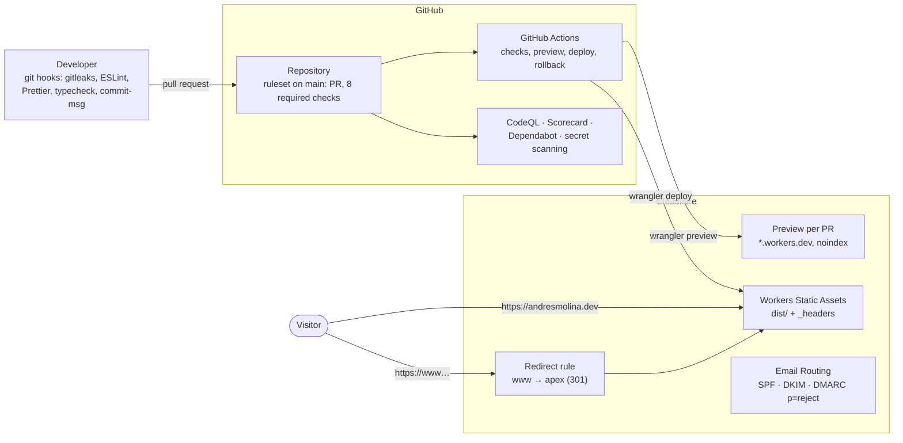
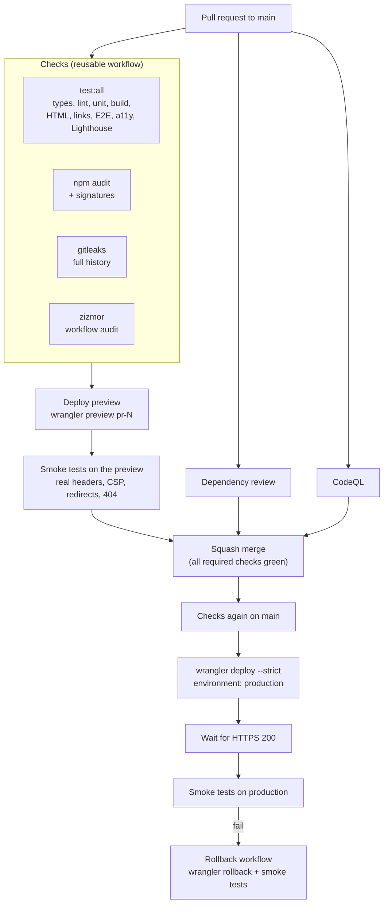

# andresmolina.dev

[](https://github.com/Milodon247/andresmolina.dev/actions/workflows/deploy.yml)
[](https://github.com/Milodon247/andresmolina.dev/actions/workflows/codeql.yml)
[](https://scorecard.dev/viewer/?uri=github.com/Milodon247/andresmolina.dev)
[](https://securityheaders.com/?q=andresmolina.dev&followRedirects=on)

Source of <https://andresmolina.dev>, the CV and portfolio of **Andrés Molina Bustamante**, DevSecOps
architect (CISSP).

It is also meant as a **reusable starting point**: a bilingual, fully static personal site with
security, quality and delivery practices you would expect from a production service. Fork it,
replace the content, point it at your domain, and you get the same pipeline and guarantees.
[Use it for your own site](#use-it-for-your-own-site) explains how.

## Highlights

- **A+** on [securityheaders.com](https://securityheaders.com/?q=andresmolina.dev&followRedirects=on)
  and [Mozilla Observatory](https://developer.mozilla.org/en-US/observatory/analyze?host=andresmolina.dev)
  (12/12 tests).
- **Strict CSP** (`default-src 'none'`) with no `unsafe-inline`, no `unsafe-eval` and no hashes,
  because the build emits **zero client-side JavaScript** and nothing inline.
- **No third-party origins**: fonts, icons and images are self-hosted. No analytics, no cookies.
- **WCAG 2.2 AA** checked with axe on every page, in light and dark mode, and **Lighthouse**
  performance ≥ 95 with 100 in accessibility, best practices and SEO, enforced in CI.
- **Bilingual** (English default, Spanish under `/es/` with translated URLs), with content
  validated by schemas: the build fails if a translation is missing.
- **Supply chain hardened**: actions pinned by SHA, least-privilege tokens, exact dependency
  versions, install scripts blocked, CodeQL, OpenSSF Scorecard, Dependabot with a cooldown, secret
  scanning in hooks and CI.
- **Every change is tested and previewed**: a pull request runs the full suite, deploys a
  Cloudflare preview and smoke-tests its real HTTP headers. Production deploys only from GitHub
  Actions, followed by smoke tests, with a one-click rollback.

## Architecture



The site is plain files: Astro renders every page at build time into `dist/`, and an assets-only
Worker serves them with the headers declared in [`public/_headers`](public/_headers). There is no
server code, database or client script to attack.

## Delivery pipeline



The build that is tested is the build that is deployed: `checks` uploads `dist/` as an artifact
and the preview and deploy jobs publish exactly that artifact.

## Technologies and why

| Area           | Choice                                                    | Why                                                                                        |
| -------------- | --------------------------------------------------------- | ------------------------------------------------------------------------------------------ |
| Framework      | [Astro](https://astro.build) 7, `output: 'static'`        | HTML at build time, zero JS by default, content collections                                |
| Language       | TypeScript, `strictest`                                   | Type errors fail the build, in `.ts` and `.astro` files                                    |
| Styles         | Tailwind CSS 4 (`@tailwindcss/vite`)                      | Utility classes compiled to one external stylesheet; light/dark via `prefers-color-scheme` |
| Content        | Content Collections + Zod                                 | CV data as JSON/Markdown with schemas; both languages required                             |
| Font           | Inter (variable, Fontsource), self-hosted                 | No Google Fonts; preload plus a metric-matched fallback to avoid layout shift              |
| SEO            | `@astrojs/sitemap`, hreflang, Open Graph, JSON-LD         | Canonical and alternate links on every page; structured data as a non-executable block     |
| Hosting        | Cloudflare Workers Static Assets                          | Global edge, custom headers, per-PR previews, versioned deploys with rollback              |
| CI/CD          | GitHub Actions + Wrangler from the lockfile               | No third-party deploy action; tokens scoped to one account and one zone                    |
| Unit tests     | Vitest                                                    | i18n, schemas, `_headers`/CSP parsing, `security.txt` expiry, repository invariants        |
| Build tests    | Vitest on `dist/`, html-validate, linkinator              | Nothing inline, no external resources, valid HTML, no broken links                         |
| Browser tests  | Playwright (Chromium, Pixel 7, iPhone 15), axe-core       | Navigation, language switch, no console errors, no external requests, WCAG 2.2 AA          |
| Performance    | Lighthouse CI                                             | Budgets on every page, three runs each                                                     |
| Code quality   | ESLint (type-aware, Astro, jsx-a11y strict), Prettier     | Run in git hooks and CI                                                                    |
| Git hooks      | lefthook                                                  | gitleaks, lint, format, typecheck before commit; Conventional Commits check                |
| Supply chain   | Dependabot, CodeQL, OpenSSF Scorecard, Dependency Review  | Updates with a 7-day cooldown; SAST on code and workflows; posture score                   |
| Workflow audit | [zizmor](https://github.com/zizmorcore/zizmor) (pedantic) | Catches injection, excessive permissions and unpinned actions in workflows                 |

## Use it for your own site

You need: a GitHub account, a Cloudflare account with your domain on it, Node (see `.nvmrc`), the
[GitHub CLI](https://cli.github.com) and [gitleaks](https://github.com/gitleaks/gitleaks).

**The code is MIT, the content is not.** The CV in `src/content/`, the name and texts in
`src/i18n/ui.ts`, and the images in `design/` and `public/` describe me and are all rights reserved
([`CONTENT-LICENSE.md`](CONTENT-LICENSE.md)): replace all of them before you publish.

### 1. Make it yours

Fork or copy the repository, then change these identifiers. A unit test keeps the production URL
consistent across the files that need it, so `npm run test:quick` tells you if you miss one.

| What               | Where                                                                                                                    |
| ------------------ | ------------------------------------------------------------------------------------------------------------------------ |
| Site URL           | `src/config/site.ts`, `site` in `astro.config.ts`, `PRODUCTION_URL` in `.github/workflows/deploy.yml` and `rollback.yml` |
| Domain             | `routes` in `wrangler.jsonc` (apex and `www`), and the Worker `name`                                                     |
| Name and repo      | `src/config/site.ts`, `public/site.webmanifest`, `package.json`                                                          |
| Page descriptions  | `meta` entries in `src/i18n/ui.ts`                                                                                       |
| Security contact   | `public/.well-known/security.txt` (and its test in `tests/security/security-txt.test.ts`), `SECURITY.md`                 |
| Images             | `design/og-default.svg`, `public/favicon.svg`, then `npm run images`                                                     |
| CV content         | `src/content/` (see [Updating the content](#updating-the-content))                                                       |
| Agent instructions | `AGENTS.md` describes this project; keep the rules, update the project description                                       |

### 2. Run it locally

```bash
nvm use                                  # or: fnm use
npm ci                                   # also installs the git hooks
npx playwright install --with-deps chromium webkit   # browsers for E2E, a11y and Lighthouse
npm run dev                              # http://localhost:4321
npm run test:quick                       # 1–2 minutes; test:all runs everything (~9 minutes)
```

### 3. Cloudflare API token

Create it in **Cloudflare dashboard → My Profile → API Tokens → Create Token → Create Custom Token**:

| Field               | Value                                                                                                         |
| ------------------- | ------------------------------------------------------------------------------------------------------------- |
| Permissions         | **Account → Workers Scripts → Edit** and **Zone → Workers Routes → Edit** (nothing else)                      |
| Account Resources   | **Include → your account** only                                                                               |
| Zone Resources      | **Include → Specific zone → your domain** only                                                                |
| Client IP filtering | Leave empty: GitHub-hosted runners have no fixed IP range                                                     |
| TTL                 | **End date ≤ 90 days**. Rotate before it expires (create a new token, update the secrets, delete the old one) |

The zone permission lets `wrangler deploy` attach the custom domains declared in `wrangler.jsonc`;
Cloudflare then creates their DNS records and certificates. Your **Account ID** is on the Workers &
Pages overview page; it is not a credential, but it is stored as a secret to keep it out of logs.

### 4. Configure the GitHub repository

[`scripts/github-setup.sh`](scripts/github-setup.sh) applies the whole configuration with the GitHub
CLI and is safe to re-run:

```bash
scripts/github-setup.sh <owner>/<repo>
```

It enables secret scanning, push protection, private vulnerability reporting, Dependabot alerts and
security updates; allows only squash merges; creates the `production` environment (deployable from
`main` only) and the `preview` environment; and creates this **ruleset for `main`**:

- Pull request required; review threads must be resolved; squash merge only.
- Required status checks (branch must be up to date): `Checks / test:all`, `Checks / npm audit`,
  `Checks / gitleaks`, `Checks / zizmor`, `Dependency review`, `Smoke tests (preview)`,
  `Analyze (javascript-typescript)`, `Analyze (actions)`.
- No force pushes, no deletion, linear history.

Then store the Cloudflare secrets in both environments (the CLI prompts for the values):

```bash
gh secret set CLOUDFLARE_API_TOKEN  --repo <owner>/<repo> --env production
gh secret set CLOUDFLARE_ACCOUNT_ID --repo <owner>/<repo> --env production
gh secret set CLOUDFLARE_API_TOKEN  --repo <owner>/<repo> --env preview
gh secret set CLOUDFLARE_ACCOUNT_ID --repo <owner>/<repo> --env preview
```

### 5. First deploy and domain

Open a pull request with your changes: it runs the checks and deploys a preview. Merging it runs
the `Deploy` workflow, which creates the Worker, attaches your domains and waits until they answer
over HTTPS before the smoke tests. Then, in the Cloudflare dashboard of your zone:

- **Rules → Redirect Rules → "Redirect from WWW to root"**: `https://www.<domain>/*` →
  `https://<domain>/${1}`, 301, preserve query string.
- Optionally **Email → Email Routing** for your contact and `security@` addresses, with a DMARC
  record (`p=reject`).

HSTS preload needs no submission for `.dev` domains (the whole TLD is preloaded). For other TLDs,
submit your domain at [hstspreload.org](https://hstspreload.org) once you are sure every subdomain
serves HTTPS.

## Commands

| Command              | Description                                                       |
| -------------------- | ----------------------------------------------------------------- |
| `npm run dev`        | Development server with hot reload                                |
| `npm run build`      | Type-check (`astro check`) and build into `dist/`                 |
| `npm run preview`    | Serve the production build locally **with the security headers**  |
| `npm run test:quick` | Typecheck, lint, format, unit, build and `dist/` checks (1–2 min) |
| `npm run test:all`   | Every check below, stopping at the first failure (~9 min)         |
| `npm run test:smoke` | Smoke tests against a deployed URL (`BASE_URL=https://…`)         |
| `npm run format`     | Format the code with Prettier                                     |
| `npm run images`     | Regenerate icons and the OG image from their SVG sources          |

## Testing

`npm run test:all` runs every step in order and stops at the first failure. Most of its time is
Lighthouse (10 pages × 3 runs). CI always runs the full suite on every pull request and before every
deployment.

| Step              | Tool                          | What it guarantees                                                                                                         |
| ----------------- | ----------------------------- | -------------------------------------------------------------------------------------------------------------------------- |
| `typecheck`       | `astro check`, `tsc --noEmit` | Strict types in `.astro` and `.ts`                                                                                         |
| `lint`            | ESLint                        | Type-aware TypeScript rules, Astro rules, strict jsx-a11y, no inline scripts                                               |
| `format:check`    | Prettier                      | Consistent formatting                                                                                                      |
| `test:unit`       | Vitest                        | Dates, i18n routes and dictionary parity, content schemas, `_headers` and CSP, `security.txt` expiry, workflow invariants  |
| `build`           | Astro                         | Content validates against schemas; every entry exists in both languages                                                    |
| `test:dist`       | Vitest                        | No inline scripts/styles, no JS files, no third-party resources, canonical + hreflang on every page                        |
| `test:html`       | html-validate                 | Valid, well-formed HTML                                                                                                    |
| `test:links`      | linkinator                    | No broken internal or external links                                                                                       |
| `test:e2e`        | Playwright                    | 200/404 status, navigation, language button, light/dark, no overflow, zero console errors, zero external requests, zero JS |
| `test:a11y`       | axe-core                      | Zero WCAG 2.2 AA violations on every page, in light and dark mode                                                          |
| `test:lighthouse` | Lighthouse CI                 | Performance ≥ 95, Accessibility = Best Practices = SEO = 100 on every page                                                 |

E2E, a11y and Lighthouse run on desktop Chromium, mobile Chromium (Pixel 7) and mobile WebKit
(iPhone 15). `npm run preview` (used by Playwright) serves the site with the headers from
`public/_headers`, so a CSP violation fails the tests locally. In CI, browser jobs run in the
official Playwright container image, pinned by digest.

## Updating the content

All CV data lives in `src/content/`. Edit the files and run `npm run build`; it fails with a clear
message if something does not match its schema (`src/content/schemas.ts`) or an entry is missing in
one of the languages.

| What                                                | File(s)                                                |
| --------------------------------------------------- | ------------------------------------------------------ |
| Name, headline, summary, about, email, social links | `src/content/profile/profile.json`                     |
| Jobs                                                | `src/content/experience/en/<slug>.md` + `es/<slug>.md` |
| Projects                                            | `src/content/projects/en/<slug>.md` + `es/<slug>.md`   |
| Certifications                                      | `src/content/certifications/certifications.json`       |
| Skills                                              | `src/content/skills/skills.json`                       |
| Interface text (menus, headings, page descriptions) | `src/i18n/ui.ts`                                       |

- Dates use `YYYY-MM`. Omit `end` on the current job.
- Translatable fields in JSON are objects: `{ "en": "…", "es": "…" }`.
- A Markdown entry uses the **same file name** in `en/` and `es/`; its body is rendered on the page.
- Links must be `https://`.
- **If your repository is public**, only add what you want on the public site: no phone number,
  home address, date of birth or ID numbers. Prefer a dedicated email alias over a personal inbox.

Example job (`src/content/experience/en/acme.md`):

```markdown
---
role: DevSecOps Architect
company: Acme
companyUrl: https://acme.example
location: Remote
start: 2023-02
technologies: [Kubernetes, Terraform]
---

- What you did and the measurable outcome.
```

English is the default language and Spanish lives under `/es/` with translated slugs (route map in
`src/i18n/routes.ts`). Every page has a visible language button linking to the same page in the
other language.

## Security

- **CSP** (`public/_headers`): `default-src 'none'` and only `'self'` for styles, images, fonts and
  the manifest. No `unsafe-inline`, no `unsafe-eval`, no hashes needed: the build emits no inline
  scripts or styles (`build.inlineStylesheets: 'never'`, no client JS).
- **Other headers**: HSTS (2 years, `includeSubDomains`, `preload`), `X-Frame-Options: DENY` +
  `frame-ancestors 'none'`, `X-Content-Type-Options`, `Referrer-Policy`, deny-all
  `Permissions-Policy`, COOP / COEP / CORP, and `Cache-Control: no-transform` so zone features
  cannot inject scripts into the pages.
- **Vulnerability disclosure**: [`SECURITY.md`](SECURITY.md) and
  [`/.well-known/security.txt`](public/.well-known/security.txt) (RFC 9116). A test fails 30 days
  before `Expires`, so it gets renewed in time.
- **Supply chain**: exact versions, committed lockfile, npm install scripts blocked by default
  (`allowScripts` in `package.json`), vulnerable transitive packages pinned with `overrides`,
  gitleaks on every commit and on the full history in CI.

`_headers` is applied by Cloudflare in production and by `astro preview` locally (minus
`upgrade-insecure-requests`, which would break `http://localhost` in WebKit). `astro dev` does not
apply it.

## Workflows

| Workflow                                             | Trigger                 | What it does                                                                                                                                           |
| ---------------------------------------------------- | ----------------------- | ------------------------------------------------------------------------------------------------------------------------------------------------------ |
| [`checks.yml`](.github/workflows/checks.yml)         | called by the two below | `test:all`, `npm audit --audit-level=high` + `npm audit signatures`, gitleaks on the full history, zizmor on the workflows. Uploads the tested `dist/` |
| [`pr.yml`](.github/workflows/pr.yml)                 | pull request to `main`  | Checks + dependency review, then `wrangler preview` of the tested build as `pr-<number>` and smoke tests against that URL (real HTTP headers)          |
| [`pr-cleanup.yml`](.github/workflows/pr-cleanup.yml) | pull request closed     | Deletes the PR's preview                                                                                                                               |
| [`deploy.yml`](.github/workflows/deploy.yml)         | push to `main`          | Checks → `wrangler deploy --strict` of the tested build (environment `production`) → smoke tests against production                                    |
| [`rollback.yml`](.github/workflows/rollback.yml)     | manual                  | `wrangler rollback` to a given (or the previous) version, then production smoke tests                                                                  |
| [`codeql.yml`](.github/workflows/codeql.yml)         | PR, push, weekly        | CodeQL `security-extended` for TypeScript and GitHub Actions                                                                                           |
| [`scorecard.yml`](.github/workflows/scorecard.yml)   | push, weekly            | OpenSSF Scorecard, published for the badge and uploaded to Code Scanning                                                                               |
| [`dependabot.yml`](.github/dependabot.yml)           | weekly                  | Grouped npm and Actions updates with a 7-day cooldown (security updates are not delayed)                                                               |

Hardening: every action pinned to a full commit SHA, `permissions: {}` by default and the minimum
per job, `persist-credentials: false`, `timeout-minutes` on every job, `concurrency` so two
production changes never overlap, no `pull_request_target`, no `${{ }}` inside `run:`, no
dependency cache in deploy paths, gitleaks installed from a checksum-verified release, wrangler run
from the lockfile. Pull requests from forks and from Dependabot run all checks but never receive
secrets or previews. zizmor (pedantic) reports no findings.

### Rollback

If the production smoke tests fail, the `Deploy` run turns red and its summary shows the version
that was live before. To restore it: **Actions → Rollback → Run workflow**, paste that `version_id`
(or leave it empty for the version before the current one) and give a reason. The workflow runs
`wrangler rollback` and the production smoke tests again. Then fix the cause in a pull request.

**Rollback restores code, not infrastructure.** Custom domains, the `workers.dev` toggle and zone
settings belong to the Worker or the zone, not to a version, so `wrangler rollback` (and even a
revert PR) leaves them as they are. If the failure is in the domain itself:

1. Check the run's logs: `Wait for production to answer` failing means DNS or certificate; a smoke
   test mentioning `/cdn-cgi/` or an unexpected header means a zone setting.
2. Fix it in the Cloudflare dashboard (Scrape Shield, Rules, SSL/TLS), or take the domain out of
   service under **Workers & Pages → your Worker → Settings → Domains & Routes** and re-enable
   `workers.dev` there.
3. Re-run the failed jobs of the `Deploy` run, or open a PR that matches `wrangler.jsonc` and
   `PRODUCTION_URL` to the state you chose.

Cloudflare keeps the 100 most recent versions restorable, and may delete versions older than 30
days. `npx wrangler deployments list` and `npx wrangler versions list` show the history.

## Project structure

```
.github/              workflows, Dependabot, Copilot instructions
astro.config.ts       site URL, static output, sitemap (hreflang), Tailwind, preview headers
wrangler.jsonc        Cloudflare Worker (static assets) configuration
public/               _headers, security.txt, icons, OG image, manifest
design/               SVG sources of generated images
scripts/              repository setup, wait-for-site, image generation, commit-msg check
tests/                unit, security, repo, dist (Vitest), e2e (Playwright + axe), smoke (deployed URL)
src/content/          CV data and its Zod schemas (schemas.ts)
src/i18n/             locales, translated route map, UI strings
src/components/       layout, SEO head, CV building blocks, shared page bodies
src/layouts/          BaseLayout
src/lib/              pure utilities and content queries
src/pages/            English routes at the root, Spanish in es/
src/styles/global.css design tokens, light/dark, print styles
```

## AI agents

Instructions for coding agents live in a single file, [`AGENTS.md`](AGENTS.md).
`CLAUDE.md`, `.github/copilot-instructions.md` and `.cursor/rules/project.mdc` only point to it.

## License

The code is released under the [MIT License](LICENSE): use it, fork it, adapt it. The personal
content (CV data, my name, descriptions and images) is © Andrés Molina Bustamante, all rights
reserved; see [`CONTENT-LICENSE.md`](CONTENT-LICENSE.md) for the exact files.
